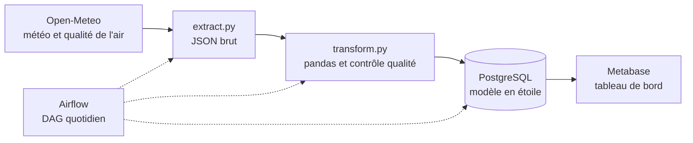
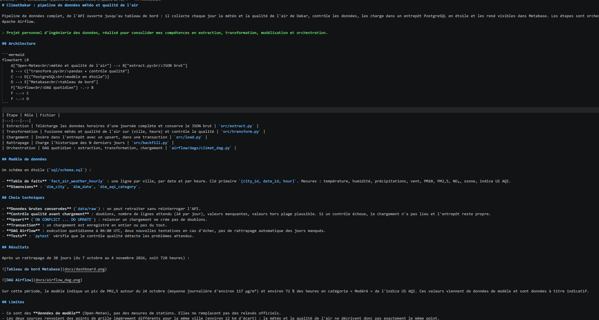
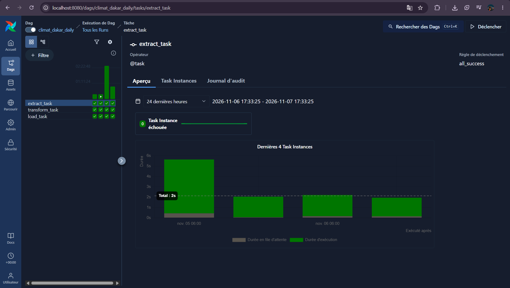

# ClimatDakar

Pipeline de données qui récupère chaque jour la météo et la qualité de l'air de Dakar, vérifie les données, les range dans un entrepôt PostgreSQL et les affiche dans un tableau de bord Metabase. Airflow lance les étapes une fois par jour.

J'ai fait ce projet pour m'entraîner à l'ingénierie des données : extraction, transformation, modèle en étoile et orchestration.

## Architecture



Les données viennent de l'API Open-Meteo. Le script d'extraction garde le JSON brut, pandas nettoie et fusionne les deux sources, puis le chargement écrit dans PostgreSQL. Metabase lit la base, et Airflow déclenche le tout chaque jour.

## Fichiers principaux

- src/extract.py : télécharge une journée complète de données horaires
- src/transform.py : fusionne la météo et la qualité de l'air, et contrôle les données
- src/load.py : charge les données dans PostgreSQL
- src/backfill.py : charge l'historique des derniers jours
- airflow/dags/climat_dag.py : le DAG quotidien
- sql/schema.sql : le schéma de la base
- tests/ : les tests du contrôle qualité

## Modèle de données

Une table de faits, fact_air_weather_hourly, avec une ligne par ville, par date et par heure (clé primaire : city_id, date_id, hour). Elle contient la température, l'humidité, les précipitations, le vent, le PM10, le PM2,5, le NO2, l'ozone et l'indice US AQI. Elle est reliée à trois dimensions : dim_city, dim_date et dim_aqi_category.

## Choix faits

- Je garde le JSON brut dans data/raw pour pouvoir retraiter les données sans rappeler l'API.
- Avant de charger, je vérifie les doublons, le nombre de lignes (24 par jour), les valeurs manquantes et les valeurs hors plage. Si un contrôle échoue, rien n'est chargé.
- Le chargement utilise un upsert : relancer un jour déjà chargé ne crée pas de doublons. Il se fait dans une transaction, donc il est enregistré en entier ou pas du tout.
- Le DAG s'exécute tous les jours à 06:00 UTC, avec deux nouvelles tentatives en cas d'échec et sans rattrapage automatique des jours manqués.
- Cinq tests pytest vérifient que le contrôle qualité repère les problèmes attendus.

## Résultats

Après un rattrapage de 30 jours (du 7 octobre au 4 novembre 2026, soit 720 heures) :





Sur cette période, le modèle indique un pic de PM2,5 autour du 24 octobre, avec une moyenne journalière d'environ 117 µg/m³, et environ 72 % des heures en catégorie Modéré de l'indice US AQI. Ces valeurs viennent de données de modèle, donc elles sont indicatives.

## Limites

- Ce sont des données de modèle (Open-Meteo), pas des mesures de stations. Elles ne remplacent pas des relevés officiels.
- Pour une même ville, les deux sources renvoient des points de grille un peu différents (environ 12 km d'écart). La météo et la qualité de l'air ne décrivent donc pas exactement le même endroit.
- Le profil horaire du PM2,5 a un palier à 12 h. Je pense à un changement de cycle de prévision du modèle, mais je ne l'ai pas vérifié.
- Il n'y a qu'une ville pour l'instant, Dakar. Pour en ajouter, il faut compléter CITIES dans src/extract.py et COUNTRIES dans src/load.py.
- La configuration est faite pour un usage local, pas pour la production.

## pour lancer le projet

Il faut Python, Docker Desktop et Git.

```
git clone https://github.com/cherif0000/ClimatDakar.git
cd ClimatDakar
python -m venv .venv
.\.venv\Scripts\Activate.ps1
pip install -r requirements.txt
```

1. Copier .env.example en .env et choisir un mot de passe pour POSTGRES_PASSWORD.

2. Démarrer l'entrepôt et Metabase :

```
docker compose up -d
```

3. Charger 30 jours d'historique :

```
python -m src.backfill 30
```

4. Airflow : dans le dossier airflow, créer un fichier .env avec AIRFLOW_UID=50000, les variables POSTGRES_* (hôte host.docker.internal) et _PIP_ADDITIONAL_REQUIREMENTS=pandas python-dotenv, puis :

```
cd airflow
docker compose up airflow-init
docker compose up -d
```

L'interface est sur http://localhost:8080, avec les identifiants définis dans airflow/docker-compose.yaml. Il faut activer le DAG climat_dakar_daily.

5. Metabase est sur http://localhost:3000. Pour ajouter la base : PostgreSQL, hôte warehouse, port 5432, base climat_dwh, et l'utilisateur de ton fichier .env.

6. Lancer les tests :

```
python -m pytest -q
```

Les fichiers .env, les journaux d'Airflow et les données ne sont pas dans le dépôt (voir .gitignore).

## Technologies

Python, pandas, SQLAlchemy, PostgreSQL, Apache Airflow, Metabase, Docker, pytest.

## Source des données

Weather data by Open-Meteo.com (https://open-meteo.com/), licence CC BY 4.0.

## Auteur

Cherif Khalla Abdel Djelil, étudiant en informatique de gestion, option science des données.